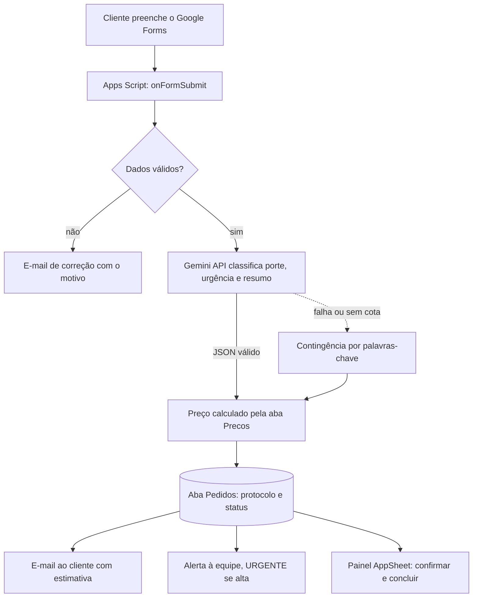
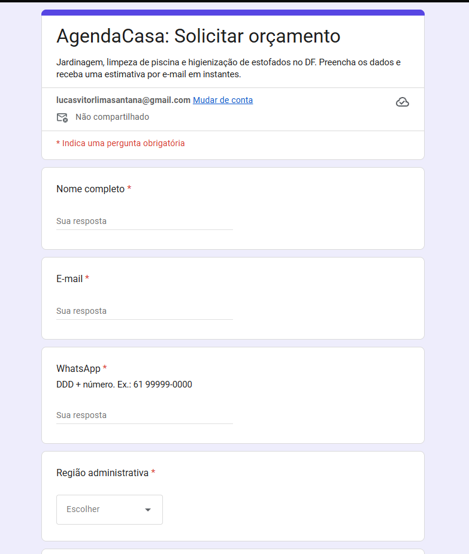
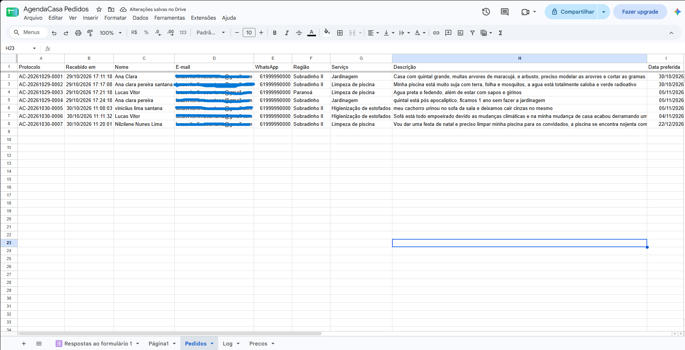
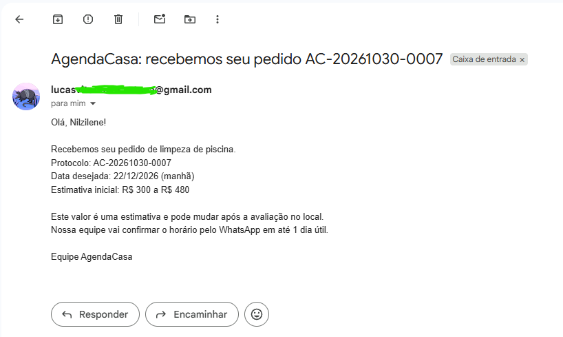
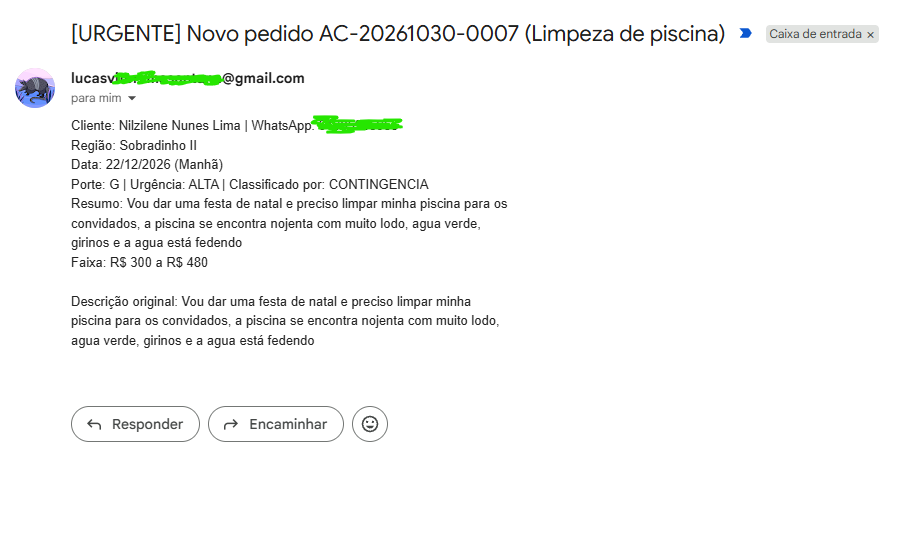
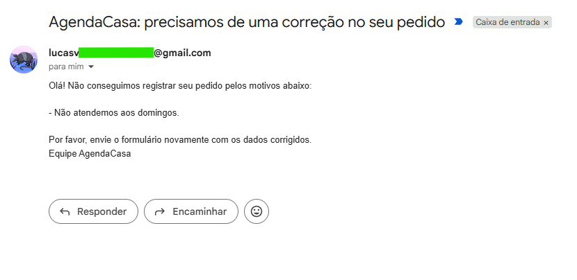
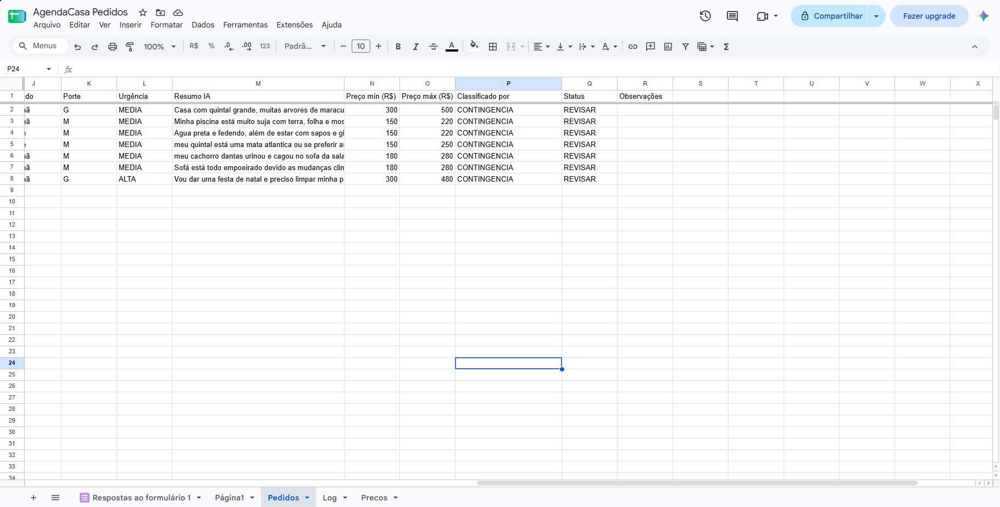
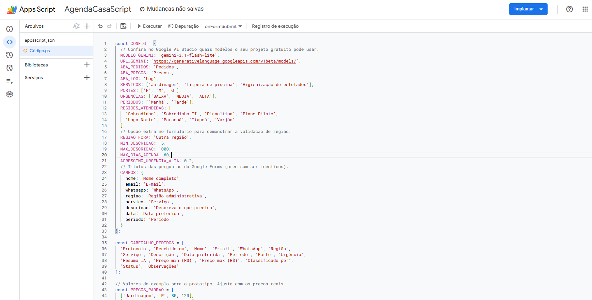
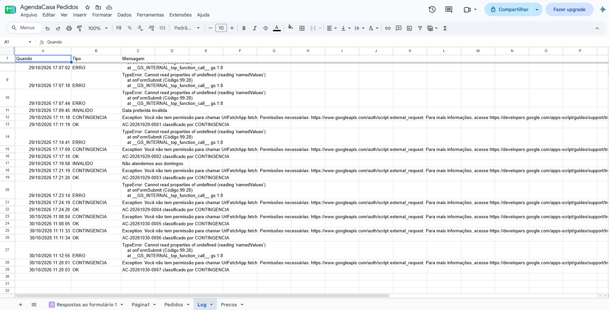
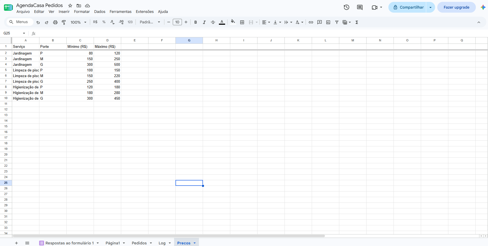

# AgendaCasa: agendamento de serviços residenciais com Low Code e IA

Protótipo funcional que transforma um pedido de orçamento enviado por formulário em um agendamento triado por Inteligência Artificial, com resposta automática ao cliente e painel para a equipe.

> Disciplina: Engenharia de Prompt / Low Code, No Code e Vibecode
> Grupo: Lucas Vitor Lima Santana, Integrante 2, Integrante 3

---

## 1. Desafio

Uma pequena empresa de serviços residenciais no Distrito Federal (jardinagem, limpeza de piscina e higienização de estofados) recebe pedidos soltos pelo WhatsApp. Os problemas:

- faltam dados para orçar (porte do serviço, região, data);
- o orçamento demora e o cliente desiste;
- pedidos se perdem entre conversas.

### Objetivos

1. Coletar pedidos com dados obrigatórios e validados.
2. Usar IA para ler a descrição livre do cliente e classificar porte e urgência.
3. Calcular uma faixa de preço automática a partir de uma tabela (sem a IA decidir preço).
4. Responder o cliente por e-mail em menos de 1 minuto, com protocolo.
5. Dar à equipe um painel no celular para confirmar e concluir atendimentos.
6. Continuar funcionando mesmo se a IA falhar.

### Fora do escopo

Pagamento online, login de cliente, integração com WhatsApp e controle de conflito de horários.

---

## 2. Plataforma escolhida e justificativa

| Camada | Ferramenta | Abordagem | Papel |
| --- | --- | --- | --- |
| Entrada | Google Forms | No Code | Formulário de solicitação |
| Dados | Google Sheets | Low Code | Abas Pedidos, Precos e Log |
| Lógica | Google Apps Script | Vibecode | Validação, chamada à IA, preço, e-mails |
| IA | Gemini API (Google AI Studio) | Integração de API | Classificação em JSON |
| Saída | Gmail (MailApp) | Nativo | E-mail ao cliente e alerta à equipe |
| Painel | AppSheet | No Code | App da equipe gerado da planilha |

**Por que o ecossistema Google:**

- **Custo zero:** tudo funciona com uma conta Google gratuita, sem cartão de crédito.
- **Combina as três abordagens:** No Code (Forms, AppSheet), Low Code (Sheets) e Vibecode (Apps Script gerado e revisado com IA).
- **Sem limite mensal de operações:** Make e Zapier gratuitos limitam execuções por mês; o Apps Script tem apenas cotas diárias de e-mail e de tempo de execução, suficientes para o protótipo.
- **Integração nativa:** formulário, planilha, e-mail e app usam a mesma autenticação; só a Gemini exige chave externa.
- **Testável:** a lógica fica em código, o que permitiu testes automatizados (seção 5).

**Alternativas consideradas:** Make/Zapier (fluxo visual bonito, mas operações limitadas no plano gratuito), Bubble (curva de aprendizado maior), ServiceNow PDI (instância hiberna e nem todo o grupo tem acesso).

---

## 3. Arquitetura do fluxo



### Regras de negócio

| Regra | Valor |
| --- | --- |
| Regiões atendidas | Sobradinho, Sobradinho II, Planaltina, Plano Piloto, Lago Norte, Paranoá, Itapoã, Varjão |
| Data do serviço | De amanhã até 60 dias, sem domingos |
| Porte | P, M ou G, com critérios por serviço (ver `docs/prompts.md`) |
| Urgência ALTA | +20% na faixa de preço |
| Status | NOVO (IA confiante), REVISAR (contingência, baixa confiança ou divergência), CONFIRMADO, CONCLUÍDO, CANCELADO |
| Protocolo | `AC-AAAAMMDD-NNNN` |

Os preços da aba Precos são valores de exemplo para o protótipo.

---

## 4. Estrutura do repositório

```
agendacasa/
├── README.md
├── src/
│   ├── Code.gs              # lógica completa do Apps Script
│   └── appsscript.json      # manifesto com permissões
├── docs/
│   ├── prompts.md           # prompts de Vibecode e prompt de produção
│   ├── casos-de-teste.md    # testes automatizados e roteiro manual
│   └── evidencias/          # prints do protótipo
└── tests/
    └── run-tests.js         # 15 testes em Node.js com mocks do Google
```

### Como reproduzir

1. Crie uma planilha Google em branco. Nela: Extensões > Apps Script. Cole `src/Code.gs` e `src/appsscript.json`.
2. Gere uma chave em [Google AI Studio](https://aistudio.google.com) e confira qual modelo Flash está liberado no plano gratuito. Ajuste `CONFIG.MODELO_GEMINI` se precisar.
3. Em Configurações do projeto > Propriedades do script, crie `GEMINI_API_KEY` e `EMAIL_EQUIPE`.
4. Execute `setupCompleto()`. Ele cria as abas, o Google Forms com as 8 perguntas já vinculado à planilha e o gatilho. Os links do formulário aparecem no registro de execução.
5. Execute `testeManual()` ou responda o formulário pelo link.
6. No [AppSheet](https://www.appsheet.com), crie um app a partir da aba Pedidos.

---

## 5. Testes e validação

Nenhuma lógica gerada por IA foi aceita sem teste. Para rodar:

```bash
node tests/run-tests.js
```

Resultado atual: **15/15 testes passando**.

| Risco | Tratamento | Teste |
| --- | --- | --- |
| Entrada inválida | Validação de nome, e-mail, WhatsApp, região, data e descrição | CT03 a CT06 |
| IA fora do ar ou sem cota | Nova tentativa e contingência por palavras-chave | CT07 |
| IA fora do formato | JSON validado contra listas fechadas | CT08, CT12 |
| Prompt injection | Descrição delimitada como dado, IA não define preço, links removidos, texto da IA não vai ao cliente | CT09 |
| Injeção de fórmula | Textos iniciados por `=`, `+`, `-`, `@` gravados como texto | CT10 |
| IA contradiz o cliente | Prevalece o serviço marcado, status REVISAR | CT11 |
| Chave exposta | Chave em Propriedades do script, fora do repositório | Revisão |

Detalhes em [`docs/casos-de-teste.md`](docs/casos-de-teste.md).

---

## 6. Evidências do protótipo

- Formulário: https://docs.google.com/forms/d/e/1FAIpQLSeUcnVTQOJj5eW_Be6r27VxZOKYiJs6_mJsAAYjrLQtm2DmQA/viewform
- Painel AppSheet: Em construção

| Etapa | Print |
| --- | --- |
| Formulário |  |
| Pedido na planilha |  |
| E-mail ao cliente |  |
| Alerta à equipe |  |
| E-mail de correção |  |
| Contingência sem IA |  |
| Código no Apps Script |  |
| Log de validações |  |
| Tabela de preços |  |

---

## 7. Reflexão crítica

### Vantagens

1. **Velocidade de entrega.** Formulário, base de dados e painel mobile saíram sem programar telas: o esforço de código ficou concentrado só na regra de negócio (um arquivo). Um sistema equivalente em Java + PostgreSQL exigiria API, banco, front-end e deploy.
2. **IA transforma texto livre em dado estruturado.** O cliente escreve do jeito dele ("sofá retrátil com mancha de café") e a IA devolve porte e urgência em JSON. Regras fixas por palavras-chave acertam bem menos variações de escrita.
3. **Vibecode acelerou o código e a revisão.** A IA gerou a primeira versão das funções, os testes com mocks e uma revisão de segurança que apontou riscos que o grupo não tinha listado (injeção de fórmula na planilha, texto da IA chegando ao cliente).

### Limitações

1. **Dependência e cotas de terceiros.** O plano gratuito da Gemini API foi restrito a modelos Flash em 2026, com cota diária baixa, e nomes de modelos mudam com frequência. Isso obrigou a criar a contingência por palavras-chave. O AppSheet gratuito bloqueia o app acima de 10 usuários.
2. **IA não é confiável sozinha.** A IA pode errar o porte, devolver JSON fora do formato ou obedecer instruções escondidas na descrição. Foi preciso validar cada campo, tirar da IA a decisão de preço e manter revisão humana (status REVISAR).
3. **Escala e manutenção limitadas.** Planilha não é banco de dados: sem integridade referencial, concorrência controlada só por lock e desempenho que cai com milhares de linhas. A lógica fica espalhada entre Forms, Sheets, script e AppSheet, o que dificulta versionar e depurar.

---

## 8. Divisão de responsabilidades

| Integrante | Papel | Entregas |
| --- | --- | --- |
| Lucas Vitor Lima Santana | Fluxos de Automação e Lógica; Integrações e IA (Vibecode) | `src/Code.gs`, integração Gemini, `docs/prompts.md` |
| Integrante 2 | Protótipo e Interface (UX/UI) | Google Forms, abas da planilha, app AppSheet, prints |
| Integrante 3 | Documentação, Testes e Apresentação | README, `docs/casos-de-teste.md`, execução dos testes, slides |

---

## 9. Próximos passos

- Enviar a confirmação pelo WhatsApp (API oficial do WhatsApp Business).
- Controlar conflito de horários com Google Calendar.
- Migrar a base para um banco de dados quando o volume crescer.
- Medir a taxa de acerto da IA comparando o porte previsto com o porte real após a visita.

---

## Referências

- [Gemini API: modelos](https://ai.google.dev/gemini-api/docs/models)
- [Gemini API: generateContent](https://ai.google.dev/api/generate-content)
- [Mudanças no plano gratuito da Gemini API em 2026](https://agentdeals.dev/gemini-api-pricing-changes)
- [Usar o AppSheet gratuitamente](https://support.google.com/appsheet/answer/10104499?hl=pt-BR)
- [Apps Script: gatilhos instaláveis](https://developers.google.com/apps-script/guides/triggers/installable)
